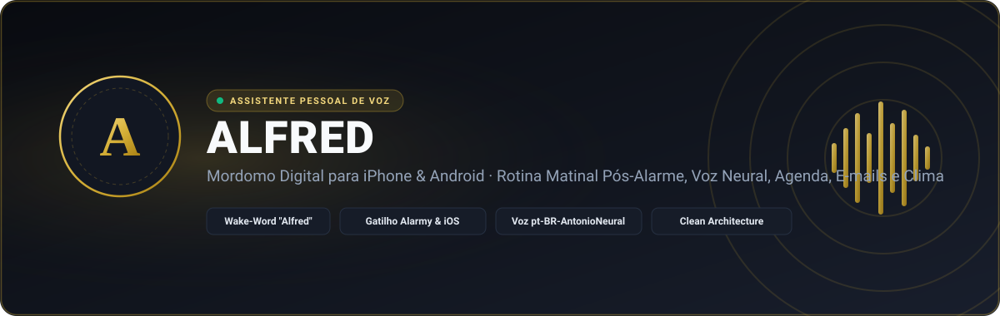
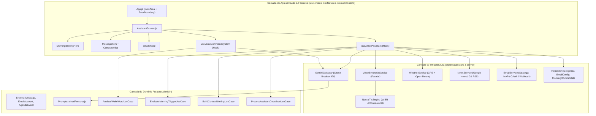
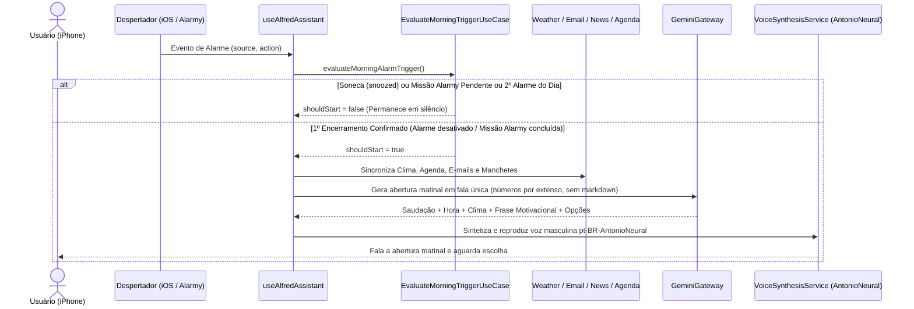
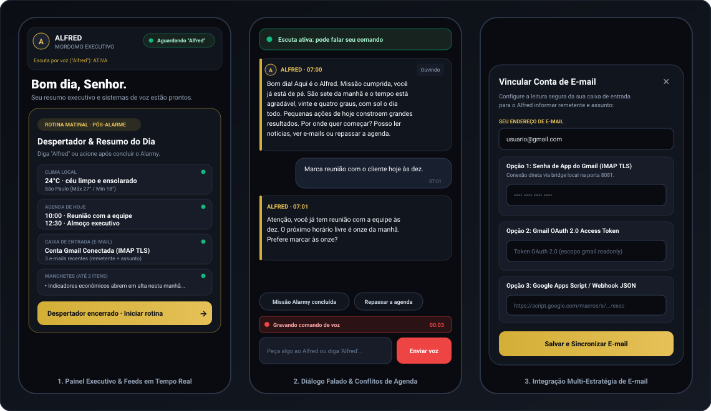

<div align="center">



<br />

[](https://reactnative.dev/)
[](https://expo.dev/)
[](https://react.dev/)
[](https://ai.google.dev/)
[](#5-arquitetura-do-sistema)
[](LICENSE)

<p align="center">
  <strong>Assistente pessoal de voz com estética executiva ("Obsidian &amp; Warm Brass"), projetado para guiar a rotina matinal logo após o encerramento do despertador (Alarme do iPhone e Alarmy) e organizar agenda, e-mails, clima e notícias ao longo do dia.</strong>
</p>

[Apresentação](#1-apresentação) •
[Identidade Visual](#2-identidade-visual) •
[Funcionalidades](#3-funcionalidades) •
[Tecnologias](#4-tecnologias-utilizadas) •
[Arquitetura](#5-arquitetura-do-sistema) •
[Instalação](#7-instalação-e-configuração) •
[Demonstração](#8-demonstração-do-sistema) •
[Testes](#9-testes-e-qualidade)

</div>

---

## 1. Apresentação

**Alfred** é um assistente pessoal de voz multiplataforma (iOS e Android), construído com **React Native** e **Expo**, que atua como um mordomo moderno, caloroso, discreto e eficiente.

### Objetivo Principal e Problema que Resolve
Ao acordar ou durante uma rotina intensa de trabalho, alternar entre múltiplos aplicativos (alarme, previsão do tempo, cliente de e-mail, portal de notícias e calendário) gera sobrecarga cognitiva e perda de foco. Além disso, assistentes genéricos frequentemente leem textos extensos com formatação inadequada, não respeitam o término real de missões de aplicativos de despertar como o **Alarmy** ou alucinam informações quando não possuem acesso à caixa de entrada.

O **Alfred** resolve esse problema unificando:
1. **Abertura Matinal Pós-Alarme Coordenada:** Inicia a rotina somente quando o alarme padrão do iPhone é desativado ou quando a missão de despertar do **Alarmy** é efetivamente concluída (ignorando sonecas e evitando repetição caso dois alarmes toquem em sequência).
2. **Interação 100% Orientada à Voz Natural:** Respostas concisas, sem markdown, listas ou símbolos, com números, horas e temperaturas escritos por extenso como se fala (*"sete da manhã"*, *"vinte e quatro graus"*) e reproduzidas por uma única voz neural masculina brasileira natural (`pt-BR-AntonioNeural`).
3. **Dados Reais Anti-Alucinação:** Integração direta com GPS/Open-Meteo, RSS do Google News Brasil / G1, caixa de entrada do Gmail (via IMAP TLS, OAuth 2.0 ou Webhook) e agenda local persistente com detecção automática de conflitos de horário.

### Contexto de Utilização e Público-Alvo
- **Usuários de iPhone (via Expo Go / Atalhos do iOS) e Android** que buscam um assistente executivo hands-free ativado pelo nome (`"Alfred"`).
- **Desenvolvedores e Arquitetos Mobile** que desejam uma referência prática de aplicação **Clean Architecture + Feature-Based Architecture**, princípios **SOLID** e **Design Patterns** em React Native.

---

## 2. Identidade Visual


A interface do Alfred segue o sistema de design autoral **Obsidian & Warm Brass** (`src/core/theme/tokens.js`), inspirado em relojoaria de precisão e painéis executivos noturnos:

- **Superfícies Obsidian (`#090B10`, `#11151E`, `#171C28`):** Baixa emissão luminosa ideal para o momento do despertar matinal e uso prolongado com alto contraste tipográfico (`WCAG AAA`).
- **Acentos Warm Brass (`#D4AF37`, `#E5C158`):** Destacam elementos de comando, insígnias do assistente e ações primárias.
- **Semântica de Status em Tempo Real:** Indicadores visuais claros para escuta em standby (`#10B981`), processamento (`#E5C158`) e captura ativa de microfone (`#EF4444`).

---

## 3. Funcionalidades

### 3.1. Gatilho Inteligente da Rotina Matinal (Alarme do iPhone + Alarmy)
- **Descrição:** Inicia a abertura matinal guiada logo após o encerramento real do despertador.
- **Como funciona (`EvaluateMorningTriggerUseCase.js` & `MorningRoutineStateRepository.js`):**
  - **Alarme padrão do iPhone:** Considera encerrado quando o usuário desativa o alarme.
  - **Alarmy:** Aguarda silenciosamente até que a missão de despertar seja concluída (`action === 'mission_completed'`).
  - **Proteção contra Soneca:** Se o usuário apenas adiar (`snoozed`), a rotina não é iniciada.
  - **Deduplicação Diária:** Se os dois alarmes tocarem em sequência na mesma manhã, o Alfred executa a abertura **uma única vez** no primeiro encerramento confirmado.
  - **Roteiro de Abertura:** Em uma única fala curta e direta, informa a saudação com a hora atual por extenso, o clima local (avisando sobre guarda-chuva se houver previsão de chuva), uma frase motivacional original e pergunta por onde o usuário deseja começar (notícias, e-mails, agenda ou novo compromisso).

### 3.2. Ativação por Voz Hands-Free (Wake-Word `"Alfred"`)
- **Descrição:** Monitoramento contínuo em standby que só processa solicitações quando o usuário chama pelo nome `"Alfred"`.
- **Como funciona (`useVoiceCommandSystem.js` & `AnalyzeWakeWordUseCase.js`):**
  - Utiliza o medidor de decibéis (`isMeteringEnabled: true` do `expo-audio`) para detectar início e término de fala humana (VAD).
  - Aplica normalização fonética para reconhecer variações de transcrição (`"Alfred"`, `"Alfredo"`, `"Ao Fred"`, `"Fred"`).
  - Ao ouvir apenas `"Alfred"`, responde imediatamente *"Sim, senhor? Estou ouvindo."* e abre uma janela armada de 25 segundos para receber o comando.

### 3.3. Voz Neural Masculina Natural Única (`pt-BR-AntonioNeural`)
- **Descrição:** Síntese de voz masculina brasileira consistente em todas as interações.
- **Como funciona (`VoiceSynthesisService.js`, `NeuralTtsEngine.js` & `server/edge-tts.js`):**
  - **Camada 1 (Principal):** Síntese neural `pt-BR-AntonioNeural` via middleware integrado ao Metro Bundler (`/alfred-tts` na porta `8081`) ou conexão WebSocket TLS direta no dispositivo (porta `443`).
  - **Camada 2 (Fallback IA):** Síntese neural masculina `Charon` via Gemini 2.5 TTS com codificação binária PCM 24kHz para RIFF WAV (`wavEncoder.js`).
  - **Camada 3 (Contingência Offline):** Voz masculina nativa do sistema via `expo-speech`.

### 3.4. Agenda Pessoal com Detecção de Conflitos e Confirmação
- **Descrição:** Consulta e criação de compromissos, eventos e lembretes por voz ou texto.
- **Como funciona (`AgendaEvent.js`, `AgendaRepository.js` & `ProcessAssistantDirectivesUseCase.js`):**
  - **Consulta:** Lista os compromissos do dia em ordem cronológica (resumindo caso haja mais de 4 eventos).
  - **Criação Inteligente:** Identifica **Título**, **Data** (interpretando datas relativas como *"hoje"*, *"amanhã"*, *"sexta"*) e **Horário**, perguntando apenas a informação que faltar.
  - **Detecção de Conflitos:** Verifica colisões de horário na mesma data e sugere automaticamente o próximo horário livre de 30 em 30 minutos.
  - **Confirmação Explícita:** Lê o resumo do compromisso e só persiste no armazenamento local após um *"sim"* explícito do usuário.

### 3.5. Leitura Inteligente e Privada de E-mails
- **Descrição:** Sincronização real da caixa de entrada do usuário sem alucinar remetentes ou assuntos.
- **Como funciona (`EmailService.js`, `EmailModal.js` & `server/imap-helper.js`):**
  - Suporta 3 estratégias de conexão (**Strategy Pattern**):
    1. **Senha de App do Gmail (IMAP TLS na porta 993)** via bridge local `/alfred-emails`.
    2. **Token OAuth 2.0 (`gmail.readonly`)** via API REST oficial do Gmail.
    3. **Google Apps Script / Webhook JSON**.
  - **Regra de Concisão e Privacidade:** Informa inicialmente apenas o **remetente** e o **assunto** dos e-mails não lidos mais importantes e pergunta: *"Quer arquivar, responder ou ouvir o resto?"*.

### 3.6. Clima Local e Notícias em Tempo Real
- **Descrição:** Atualização meteorológica por geolocalização e resumo das principais manchetes do dia.
- **Como funciona (`WeatherService.js` & `NewsService.js`):**
  - Obtém coordenadas GPS via `expo-location`, consulta temperatura atual, sensação térmica, máximas/mínimas e probabilidade de chuva no **Open-Meteo** e identifica a cidade via **BigDataCloud Reverse Geocoding**.
  - Consome feeds RSS em tempo real do **Google News Brasil** e **G1**, resumindo até 3 manchetes em uma frase cada antes de perguntar se o usuário quer detalhes de alguma.

---

## 4. Tecnologias Utilizadas

| Categoria | Tecnologias e Bibliotecas |
| :--- | :--- |
| **Frontend Mobile** | React Native `0.88.1`, React `19.3.0`, Expo SDK `58.0.24`, JavaScript (ES2022 / JSX) |
| **Áudio & Voz** | `expo-audio` (gravação com metering VAD + reprodução nativa), `expo-speech`, Microsoft Edge Neural TTS (`pt-BR-AntonioNeural`), Codificador binário RIFF/WAV (`wavEncoder.js`) |
| **Inteligência Artificial** | Google Gemini API & Gemma 4 (`gemma-4-31b-it`, `gemma-4-26b-a4b-it`, `gemini-2.5-flash-lite`, `gemini-2.5-flash`) com Circuit Breaker de quota (`HTTP 429`) |
| **Backend / Middleware Local** | Node.js (`metro.config.js` custom middleware na porta `8081`, `server/edge-tts.js` via TLS WebSocket, `server/imap-helper.js` via TLS IMAP `993`) |
| **Persistência Local** | `expo-file-system` (`EmailConfigRepository`, `AgendaRepository`, `MorningRoutineStateRepository` e cache de arquivos MP3/WAV) |
| **APIs e Integrações** | `expo-location`, Open-Meteo Forecast API, BigDataCloud Reverse Geocoding API, Gmail IMAP / Gmail REST API v1, Google News Brasil / G1 RSS |
| **Testes e Qualidade** | Node Test Runner + `@babel/parser` / `@babel/core` (`tests/run-tests.js`) |

---

## 5. Arquitetura do Sistema

O projeto adota **Clean Architecture** combinada com **Feature-Based Architecture**, garantindo baixo acoplamento, alta coesão e aderência aos princípios **SOLID**.

### 5.1. Diagrama da Arquitetura em Camadas



### 5.2. Fluxo do Gatilho da Rotina Matinal e Diálogo por Voz



---

## 6. Estrutura de Diretórios

```text
alfred/
├── App.js                                         # Root component enxuto com ErrorBoundary e SafeAreaView
├── index.js                                       # Registro do componente raiz no Expo
├── app.json                                       # Configurações de manifesto do Expo (iOS, Android, plugins)
├── config.js                                      # Leitura segura de EXPO_PUBLIC_GEMINI_KEY via ambiente
├── metro.config.js                                # Middleware Metro (/alfred-tts e /alfred-emails na porta 8081)
├── package.json                                   # Dependências e scripts (start, ios, android, test)
├── .env.example                                   # Modelo documentado de variáveis de ambiente (sem segredos)
├── SECURITY.md                                    # Política de segurança e privacidade
├── CONTRIBUTING.md                                # Guia de arquitetura e padrões de contribuição
├── CHANGELOG.md                                   # Histórico de versões e melhorias
├── docs/
│   └── images/                                    # Recursos visuais do projeto (Banner, Logo e Telas)
│       ├── alfred-banner.svg
│       ├── alfred-logo.svg
│       └── alfred-ui-preview.svg
├── server/
│   ├── edge-tts.js                                # Cliente WebSocket TLS para síntese neural pt-BR-AntonioNeural
│   ├── imap-helper.js                             # Cliente IMAP TLS (porta 993) para leitura de e-mails
│   └── gmail-bridge.js                            # Servidor bridge standalone opcional
├── src/
│   ├── core/
│   │   ├── config/constants.js                    # Resolução dinâmica de IP via SourceCode.scriptURL e constantes
│   │   ├── errors/AppError.js                     # Classe estruturada de erro e detecção de quota HTTP 429
│   │   ├── errors/ErrorBoundary.js                # Captura global de falhas de renderização na UI
│   │   └── theme/tokens.js                        # Design System Obsidian & Warm Brass
│   ├── domain/
│   │   ├── entities/
│   │   │   ├── AgendaEvent.js                     # Entidade de agenda com detecção de conflitos e próximo horário livre
│   │   │   ├── EmailAccount.js                    # Entidade e validador de credenciais de e-mail
│   │   │   └── Message.js                         # Factory Method para mensagens do chat
│   │   ├── prompts/alfredPersona.js               # Identidade, estilo de voz falado e regras de negócio do Alfred
│   │   └── useCases/
│   │       ├── AnalyzeWakeWordUseCase.js          # Detecção fonética da wake-word "Alfred"
│   │       ├── BuildContextBriefingUseCase.js     # Construção determinística de contexto em tempo real
│   │       ├── EvaluateMorningTriggerUseCase.js   # Regras do gatilho pós-alarme (iPhone + Alarmy)
│   │       └── ProcessAssistantDirectivesUseCase.js # Extração de tags de agenda e limpeza de markdown para voz
│   ├── infrastructure/
│   │   ├── ai/GeminiGateway.js                    # Gateway Gemini/Gemma 4 com Circuit Breaker de quota
│   │   ├── http/httpClient.js                     # Cliente HTTP com AbortController e timeout
│   │   ├── integrations/
│   │   │   ├── EmailService.js                    # Strategy Pattern (IMAP Bridge, Webhook, Gmail OAuth)
│   │   │   ├── NewsService.js                     # Leitor de feeds RSS (Google News Brasil / G1)
│   │   │   └── WeatherService.js                  # GPS + Open-Meteo + BigDataCloud Reverse Geocoding
│   │   ├── repositories/
│   │   │   ├── AgendaRepository.js                # Persistência local de compromissos
│   │   │   ├── EmailConfigRepository.js           # Persistência local de configuração de e-mail
│   │   │   └── MorningRoutineStateRepository.js   # Controle diário de deduplicação do alarme matinal
│   │   └── speech/
│   │       ├── NeuralTtsEngine.js                 # Motor TTS neural híbrido (Metro 8081 + WebSocket TLS 443)
│   │       └── VoiceSynthesisService.js           # Facade de reprodução de áudio e cache
│   ├── features/
│   │   ├── briefing/components/                   # MorningBriefingHero e QuickActionsBar
│   │   ├── conversation/                          # MessageItem, ComposerBar e useAlfredAssistant
│   │   ├── email/components/                      # EmailModal
│   │   └── voice/hooks/                           # useVoiceCommandSystem (VAD + Wake-Word)
│   ├── components/
│   │   ├── layout/HeaderBar.js                    # Cabeçalho executivo com controles de voz
│   │   └── ui/                                    # ArmedListeningBanner e ThinkingIndicator
│   ├── screens/AssistantScreen.js                 # Tela principal da aplicação
│   └── utils/                                     # formatters.js e wavEncoder.js
└── tests/
    └── run-tests.js                               # Suíte automatizada de testes de domínio e validação AST
```

---

## 7. Instalação e Configuração

### 7.1. Pré-requisitos
- **Node.js** `>= 18.x` (recomendado `20.x` ou `24.x`) e **npm**.
- Aplicativo **Expo Go** instalado no iPhone (iOS) ou smartphone Android conectado à mesma rede Wi-Fi do computador.
- Uma chave de API do **Google Gemini** gerada no [Google AI Studio](https://aistudio.google.com/).

### 7.2. Clonagem do Repositório

```bash
git clone https://github.com/eltoncelestino/alfred.git
cd alfred
```

### 7.3. Instalação das Dependências

Utilize o comando recomendado pelo Expo para garantir compatibilidade com o SDK:

```bash
npx expo install
```

### 7.4. Configuração das Variáveis de Ambiente

Copie o arquivo `.env.example` para `.env.local` (o arquivo `.env.local` é ignorado pelo Git por segurança):

```bash
cp .env.example .env.local
```

Edite o arquivo `.env.local` e insira sua chave da API Gemini:

```env
EXPO_PUBLIC_GEMINI_KEY=SUA_CHAVE_GEMINI_AQUI
EXPO_PUBLIC_DEFAULT_USER_EMAIL=seu.email@gmail.com
REACT_NATIVE_PACKAGER_HOSTNAME=
```

> **Nota:** O IP da sua máquina na rede Wi-Fi é detectado automaticamente pelo `metro.config.js` e pelo `constants.js` (`NativeModules.SourceCode.scriptURL`). Caso utilize múltiplas interfaces de rede virtuais (VPN/WSL), você pode informar seu IP Wi-Fi local em `REACT_NATIVE_PACKAGER_HOSTNAME`.

### 7.5. Inicialização e Acesso à Aplicação

Inicie o servidor de desenvolvimento com limpeza de cache do bundler:

```bash
npx expo start --clear
```

1. Abra o aplicativo **Expo Go** no seu iPhone ou Android.
2. Escaneie o QR Code exibido no terminal ou selecione **alfred** na seção **Recently in development**.
3. Conceda as permissões de **Microfone** (para a escuta `"Alfred"`) e **Localização** (para o clima local).

### 7.6. Solução de Problemas Comuns

- **Erro `Could not connect to the server` no iPhone:** Certifique-se de que o computador e o iPhone estão na mesma rede Wi-Fi e que a rede está configurada como **Rede Privada** no Windows Firewall (permitindo conexões na porta `8081` do Metro Bundler).
- **Limite de cota da API Gemini (`HTTP 429`):** O `GeminiGateway` possui um **Circuit Breaker** automático que alterna entre `gemma-4-31b-it`, `gemma-4-26b-a4b-it`, `gemini-2.5-flash-lite` e `gemini-2.5-flash`. Se todos os modelos gratuitos atingirem o limite por minuto, aguarde 30 segundos e tente novamente.
- **Leitura de E-mails do Gmail via IMAP:** Para usar a Opção 1 no modal **Vincular meu E-mail**, gere uma **Senha de App de 16 caracteres** na sua Conta Google (`myaccount.google.com/apppasswords`) com a verificação em duas etapas ativa.

---

## 8. Demonstração do Sistema

Abaixo está a representação visual fiel das três telas e fluxos principais implementados nos componentes do **Alfred** (`MorningBriefingHero`, `AssistantScreen` com diálogo falado/detecção de conflitos de agenda e `EmailModal`):

<div align="center">
  
</div>

---

## 9. Testes e Qualidade

O projeto conta com uma suíte automatizada (`tests/run-tests.js`) que valida:
1. **Análise Estática de AST e Imports (`@babel/parser`):** Verifica 100% dos arquivos `.js`/`.jsx` garantindo que não existam erros de sintaxe ou imports quebrados.
2. **Testes Unitários de Casos de Uso (`src/domain/`):**
   - Reconhecimento fonético da wake-word `"Alfred"` e filtragem de ruído ambiente.
   - Detecção de intenção direta de comando.
   - Regras do gatilho matinal pós-alarme (bloqueio em modo soneca, espera pela conclusão da missão do Alarmy e deduplicação diária de alarmes em sequência).
   - Detecção de colisão de horários na Agenda e cálculo automático do próximo horário livre.
   - Extração de diretivas `[[AGENDA_SAVE:...]]` e remoção de formatação markdown para leitura limpa em voz alta.

Para executar todos os testes localmente:

```bash
npm test
```

---

## 10. Roadmap

### Implementado
- [x] Arquitetura modular baseada em **Clean Architecture + Feature-Based Architecture** e princípios **SOLID**.
- [x] Gatilho de Rotina Matinal Pós-Alarme com regras específicas para **Alarme do iPhone** e **Alarmy** (incluindo suporte a Deep Link para Atalhos do iOS).
- [x] Escuta em standby por palavra de ativação (`"Alfred"`) com VAD e janela armada.
- [x] Síntese de voz neural masculina única (`pt-BR-AntonioNeural`) com cache e fallback em múltiplas camadas.
- [x] Agenda local com consulta cronológica, detecção de conflitos de horário, sugestão de próximo horário livre e confirmação explícita.
- [x] Integração em tempo real com Clima (Open-Meteo + GPS), Manchetes (Google News / G1 RSS) e E-mails (IMAP Bridge / OAuth / Webhook).

### Em Desenvolvimento
- [ ] Sincronização bidirecional da agenda local com o Apple Calendar / Google Calendar via `expo-calendar`.
- [ ] Envio direto de respostas de e-mail via SMTP TLS após confirmação do rascunho falado.

### Planejado
- [ ] Migração gradual das camadas `domain` e `infrastructure` para TypeScript Strict (`.ts` / `.tsx`).
- [ ] Criptografia de credenciais locais com `expo-secure-store` (iOS Keychain / Android Keystore) em build nativo EAS.

---

## 11. Licença e Autoria

Este projeto está licenciado sob a **MIT License** — consulte o arquivo [LICENSE](LICENSE) para mais detalhes.

---

<div align="center">

**Desenvolvido por Elton Celestino.**

🔗 **Repositório Oficial:** [https://github.com/eltoncelestino/alfred](https://github.com/eltoncelestino/alfred)

</div>
